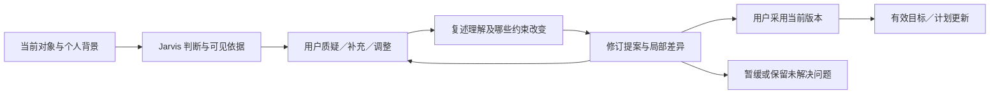

# Jarvis：把每一处 AI 建议变成可协商的共同成果

研究日期：2026-10-02。承接 [Agent-Native 官方应用交互研究](agent-native-interaction-patterns.md)、[框架核查](builderio-agent-native.md) 与 [AI-native 游戏化研究](ai-native-gamification.md)。对应用户的新反馈：今日与成长总览的结构已更清楚，但榜样设置、gap 分析、安排建议等环节缺少贴近当前对象的 Jarvis 反馈与讨论，难以逐步修正到用户真正认同的方案。

**本轮建议：保留两个主页面，为每个重要 AI 判断增加就地讨论与纠正入口；讨论携带具体对象和最新背景，反馈实际改变可审阅的方案，用户采用当前版本后才更新有效目标／计划。** 一块共享的讨论面板即可覆盖这些入口，不需要为每个位置增加独立聊天应用。

AI-native 的重要变化不是把所有控件改成对话，而是让**直接编辑、专业分析、对话修正和实际应用共同操作同一份成果**。用户能问“为什么推荐这个榜样”“这段差距不符合我的目标”“只剩 20 分钟怎样改”，不用重新解释整个生活背景；Jarvis 必须展示如何理解反馈、哪些判断改变了、哪些仍缺证据。[S1–S8][H1–H4]

## 1. 证据范围：本轮实际查了什么

### 已读取的一手材料

- BuilderIO 官方仓库本轮固定在 **`53f0c01162469742fdf46a63010a4635d3ba2140`**，提交时间 `2026-10-02T03:01:58Z`；核验 `@agent-native/core` **0.199.0**。通过 GitHub 官方 API 核实提交，并从固定 SHA 读取 README、上下文／原生聊天文档、当前选择、后续建议、Content 提案、Calendar 草稿、Tasks 建议与应用、UI 执行限制等源码或相关片段。[S1–S8] 相比旧报告的 `d2b14cf…`／0.198.2，这是新的核查快照；没有升级项目依赖。
- Eric Horvitz，*Principles of Mixed-Initiative User Interfaces*（CHI 1999），读取作者本人网站托管的 **9 页 PDF 全文**，重点复核 PDF 1–2 的 12 项原则及 LookOut 日历案例。[H1]
- Microsoft Fluent 官方公开页 **Responsible AI、Types of AI harm、Wait UX、Design principles**，实际读取原则、交互策略、反馈与适用限制。[H2–H5]
- Linear 官方 **AI Agents** 文档，实际读取委派、指导、活动可见性与人类负责人的说明。[A1]
- 项目内两份 Agent-Native 研究及本轮原型 `/tmp/jarvis-ai-native` 的 README、设计文档与相关 UI 源码片段，用于定位建议入口的缺口。该静态阅读不是完整浏览器测评，也不是对实施完成状态的声明。

### 未获得可读正文的材料

Amershi 等的 *Guidelines for Human-AI Interaction*（CHI 2019，DOI `10.1145/3290605.3300233`）通过出版方登记核验题录；Microsoft Research、ACM 与 HAX Toolkit 入口返回 403，作者网站访问失败，学术索引未给出可用开放 PDF。因此**本轮不声称重读了论文全文或 HAX 全套指南**，也不将记忆中的具体条目冒充本轮核验结论。[H6]

Fluent 的若干 Copilot 组件页面在 sitemap 可发现，但实际跳转员工登录：输入建议、消息、引用、错误组件页均不作为已读证据；最初尝试的 `/ai`、`/copilot` 是带 200 状态的 404 页面，也不算内容阅读。公开的 `responsible-AI`、`ai-harm`、`wait-ux` 页提供了本轮可直接采用的原始设计依据。[H2–H5]

Notion AI／Agent 官方帮助页连接失败，OpenAI Canvas 官网／帮助页返回 403，因此本报告**不借这些产品的未经核查印象论证设计**。有来源的产品实例以 BuilderIO 与 Linear 为主。[A1]

以上访问范围可以支持具体交互设计与源码契约判断；没有安装、启动、认证或执行这些官方应用，没有接触私人历史、模型凭据、第三方收费服务。源码存在某能力不代表 Jarvis 已经接入该能力。

## 2. 研究结论：从 AI 输出到共同工作对象

### 2.1 BuilderIO：共享对象、共享状态、共享动作

官方 README 的基础是共享 actions、数据与应用状态。当前 `context-awareness.mdx` 区分语义导航、URL、selection、`view-screen`、`sendToAgentChat()` 和 `navigate`：UI 记录轻量对象 ID，Agent 按需取最新记录，界面操作能交给同一 Agent turn。[S1–S2]

这对 Jarvis 的含义十分具体：

- 点击榜样卡的讨论入口，讨论对象是**这个模块的这份参照**，不是默认问“你想聊什么”。
- 点击 gap 的一个维度，带入指标定义、基线证据、目标与当前比较范围。
- 点击任务的安排建议，带入该合约、今日容量、固定事项和当前草案。
- 点击验收结论，带入标准、提交证据、帮助程度与原判定，允许针对某一项纠正。

“基于个人背景”的文字标签不能替代真实选择上下文。“我已经了解你”也不能替代可见的资料出处。

### 2.2 Content：可审阅的修改是 AI 回复的一部分

官方 `suggest-document-edit` 明确先读当前文档，再带 `baseRevision` 与 `idempotencyKey` 提议修改；源码构造 before／after，保持正文不变，直到 reviewer 接受。`decideResourceSuggestionProposal` 用事务检查精确的成员版本；成员已变化则拒绝整组应用。[S3]

对应的产品模式是：**用户不是批准一句“我建议降低目标”，而是查看“原目标 → 新目标、原验收 → 新验收、原预算 → 新预算”的共同成果。** 继续讨论应修订同一提案，而不是连续生成互不关联的对话结论。新背景变化使旧提案失效，不能把昨天确认的参数当今天仍然有效。

通用 review action 的 reviewer 权限并不自动等于 Jarvis 的“用户本人最后确认”；`uiOnly` 在当前版本拒绝非 `frontend` caller，但用户身份、业务版本与幂等仍是 Jarvis 自己需要维护的边界。[S3][S8]

### 2.3 Slides：讨论范围必须跟随选中对象与版本

`buildSlidesAgentContext` 把 deck、slide、selection revision 与选中元素组合成 `contextVersion`，并提供“当前选择／当前页”的范围标签。[S4]

Jarvis 应显示一个可读讨论范围：“正在讨论：Agent 实践 · 榜样参照”，或“今天 14:00 的基线实验”。用户切换到健康模块时，不得让较慢的技术建议覆盖健康面板。对旧对象的回应可以保留在原讨论中，但应用按钮要检查当前版本与对象。

### 2.4 Tasks 与 native chat：回复需要直接可操作

Tasks 通过独立 suggest／apply 操作分开分析与修改，建议允许“没有足够信息”；原生聊天使用验证后的 typed JSON 和明确 renderer 把结果变成真实控件，不从任意 JSON 猜 UI，也不执行返回的 HTML。[S5][S7]

Jarvis 应让对话中的“调整后的参照卡／计划差异卡／验收证据卡”与主页面引用同一个 ID。点击修改，在主页面与对话中都可见；在主页面直接编辑，也会成为下一轮分析的输入。文本解释有价值，但回复只停留在段落中，用户仍须自己把它重做一遍，便没有形成真正的共同工作。

### 2.5 Follow-ups：下一步依据本次结果，而不是固定凑按钮

当前源码将两类提示分开：`dynamic-suggestions.ts` 根据对象类型生成预置入口；`follow-up-suggestions.ts` 要求根据请求、对话、当前上下文与已经发生的结果，生成 **0–3** 个有意义的下一意图，允许为空、禁止重复已完成工作。后者只是元数据，**不会执行建议**。[S6]

Jarvis 可以把固定入口用于发现能力，把本轮下一步用于继续协商：已有草案时“解释两处取舍／只缩这项任务”；缺关键资料时只问该资料；已完成证据验证时“查看下一关”。今日已经足够时，可以结束，不要为了互动量继续添任务。

## 3. Human–AI 设计依据及其实际约束

### Horvitz：自动化与直接操控共同发起、共同修正

原文指出 Agent 常见问题是误猜用户目标、未考虑自动行动成本、时机不当，以及不给用户修正分析的机会。其原则强调：

1. 自动化要带来相对直接操作的真实增益。
2. 考虑对用户目标和注意力的未知，避免不合时宜的打断。
3. 用高效对话解决**关键**不确定性，不无谓打扰。
4. 用户可以直接启动或终止协助。
5. 让服务精度与证据不足相匹配：在不确定时做少一点但做对，比大胆误操作更可取。
6. 默认用户会补全、修正 Agent 的结果；保留近期共享对象，使“这条／刚才那个”自然成立。[H1，PDF 1–2]

LookOut 日历实例解析当前邮件，呈现推测结果，让用户编辑并保存；无法确定准确日期时降为适当时间范围而不是乱填精确时间。[H1，PDF 2–3] Jarvis 可相应降级：没有可比跑步记录时，先提出“建立同口径基线”，而不是输出精确 gap；不知道技术水平时，先形成可复核的小作品任务，不声称已测出能力分。

### Fluent Responsible AI：用户能改变输入、修正输出和逆转操作

本轮可读的官方原则包括透明、合理预期、避免过度依赖、用户控制和反馈。其 UI 策略要求说明建议依据、资料范围、能力限制与下一步；让用户能改变输入并用进一步指令细化输出。控制标准明确列出 stop、change、edit、confirm、delete、forget、revert；反馈应置于当前 AI 交互上下文中。[H2]

因此“满意／不满意”的二值评分不足以满足此需求。反馈需要针对实际问题：**事实错了、目标理解偏了、证据不足、预算不合适、想走另一条路线**。它首先帮助用户完成眼前的共同任务，而不是先把反馈交给产品团队或模型训练。[H2–H3]

官方还提醒过度自信的 UI、来源缺失和奉承式熟悉感会让用户误判可靠性。Jarvis 的专业、温暖和陪伴定位可以保留，但专业感应来自有依据的分析与诚实修正，不能用“你一定可以／你已经是专家”替代证据。显示“建议依据与不确定性”即可，不应把未公开的模型思维过程包装为可验证事实。

**适用边界：**Fluent 的内部 RAI 评分、微软批准的免责声明、发布审查与品牌风格是微软自己的产品政策，不是本项目的审批要求。本轮借用其用户控制与反馈原则，不搬来内部审核流程、免责声明墙或品牌组件库。

### Fluent Wait UX：等待应保持局部上下文

官方公开页要求清楚、诚实地说明正在发生什么，维持当前视图，将反馈绑定到相应操作，避免多个加载提示竞争注意力；能够测量时显示真实进度，否则使用不确定等待指示；状态需可被辅助技术读取。[H4]

Jarvis 在分析某条 gap 时不应切走整个页面，或同时让所有模块播放“正在研究”。真实版可显示“读取当前证据／比较参照条件／草案可审阅”；模拟原型必须注明规则模拟，不以人为延迟与阶段文字冒充执行了实时检索。

### Linear：委派保留人类负责人，指导与活动持续可见

Linear 官方文档说明，向 Agent 委派 issue 时人类仍是主要 assignee／owner；可以在评论或描述中 mention Agent；指导有版本历史，Agent 活动仍在 issue／用户页与自定义视图中可见；指导怎样被理解取决于具体集成。[A1]

Jarvis 不需要复制 issue 管理或团队系统；可借用的结构是：**每个目标／任务有自己的对话与活动，用户始终拥有它，指导可以更新，自动化结果不能脱离原对象。** 这也是将反馈放在榜样、差距和计划卡片旁的实际应用依据。

## 4. “直到一致”应是什么，不能是什么

用户希望双方交流直到一致，可以实现为：



**方案一致：**用户的目标和约束得到准确表达，Jarvis 的建议可解释、可行且没有被证据否定；用户采用该版本。可以显示简洁的“共同确认：今天保留固定基线，迁移检验明日再做”。

**事实一致：**用户提供的事实与来源能被记录和更正；新叙述不必自动覆盖旧证据，应处理时间与来源冲突。

**证据判定：**不能通过聊天达成“没有证据也算已掌握”。用户可以改变目标、选择不同路线、决定今天只做最低行动，也可以质疑 rubric；但真实能力判定仍须受相应证据约束。

对话可以形成“仍待验证，但采用这个下一步”的有用结果；不强迫双方对每个解释达成一致，不把不同意判成失败。查看理由、比较两条路线和补充一个问题无需增加确认门；真正修改有效目标、计划和评分口径时复用已有明确采用入口。

## 5. Jarvis 的检查点交互矩阵

下表是**本轮产品设计推导**，不是上游已有 Jarvis API。每行均应至少有一个就地入口，并能携带当前对象自由讨论；默认显示一两个最相关操作，其他收入展开，不在所有卡片铺满五个按钮。

| 检查点 | Jarvis 应解释／反馈什么 | 就地入口与用户输入 | 讨论后的真实成果 | 确认边界 |
| --- | --- | --- | --- | --- |
| **新增模块与意愿** | 它怎样理解方向，哪些背景已知、哪些会影响判断 | “目标理解不对／补充起点／和 Jarvis 定义目标”；允许本人重新措辞 | 明确的目标草案、待评估维度与最小基线任务 | 建模块可直接确认；专业路线另形成提案 |
| **榜样候选推荐** | 为什么这个人物／作品适合阶段，具体可学能力，来源和限制 | “为什么推荐／另一个榜样／只参考这项能力／我的条件不同” | 候选比较、保留／排除理由，修订参照维度 | 采用参照时确认；研究与比较不改有效参照 |
| **自选榜样** | 用户欣赏的是成就、方法还是价值；哪些公开成果可查 | “我更想学他的 X／这来源不可靠／换近阶段参照” | 待核查人物与成果、来源状态、近远目标区分 | 未核查来源不能自动成为可信高线 |
| **现状基线** | 当前数值／能力结论如何从记录得来，信息时间与帮助程度 | “这条记录过期／不是我的结果／补一项作品／重新测” | 更正关系、重新评估草案、保留可追溯原记录 | 事实更正与能力升级分开处理 |
| **gap 的具体维度** | 指标口径、可比范围、差值或清单缺口；不确定项 | “这个比较不公平／调整目标／这项已会／再解释差距” | 修订比较口径、待复核证据、重算后的局部 gap | 不能用用户意见直接制造验证结果 |
| **模块评分口径** | 分项、权重／方向、未知项及展示尺度含义 | “我更看重持续性／别用这个指标／解释权重” | 新口径草案及历史影响说明 | 采用当前版本；历史不静默改算 |
| **阶段路线与能力前置** | 为什么先补这个缺口，可选路线、时间与机会成本 | “跳过基础／我已能做／换作品／讨论下一阶段” | 修改阶段清单、验证前置的替代证据、下一任务 | 路线可协商，必要前置需证据 |
| **今日局势与主线** | 为什么今天优先这个领域；用了哪些状态与承诺 | “理解错了／今天重心不同／补一个约束” | 推荐排序与今日草案变化，标明相关背景变化 | 不因修改解释就删除已确认安排 |
| **任务／挑战档位** | 这个档位的产物、验收、预计负担、成长作用 | “只剩 20 分钟／太简单／我想换方法／讨论任务” | 修改同一合约的时间、检查点与验收，显示影响 | 不能只缩时而保持不可能的完整验收 |
| **日历提案与取舍** | 新增／移动／缩小什么，为什么，保留与让出的价值 | “这段不能动／只改这个／另一种安排／继续讨论” | 当前日历旁的版本化差异草案，约束重新校验 | 最终采用一次生效；旧版本不能应用 |
| **开始锚点** | 为什么选这个触发时机；备用行为是否可做 | “这个习惯不稳定／改地点／加打断备用方案” | 本次可编辑实施意图与备用行动 | 简单手动编辑可复用任务草案 |
| **执行遇阻与提示** | 卡在技能、材料还是环境；提示范围与帮助程度 | “给线索／一起拆解／直接示范／先暂停” | 有限提示、调整检查点或改期草案；保留已完成证据 | 提示不自动宣称独立掌握；允许停止 |
| **部分完成／证据补记** | 怎样理解实际做了什么，哪些只属自述 | “这部分没做／遗漏了产物／调整记录／继续复盘” | 真实记录修订，奖励幂等更新，旧证据保留 | 不把缺记录当失败，不重复发奖 |
| **能力验收判定** | 哪项已验证、部分支持或未知，引用具体证据 | “解释判定／这个反例不成立／补证据／重新评估” | 按 rubric 的复核意见与待验证项 | 用户确认记录≠真实测试通过；模拟必须标明 |
| **每日安排与完成评估** | 计划假设、实际偏差、有效产物与外部打断分别是什么 | “不是拖延／家庭打断／时间估错／换下次策略” | 对原因的修正、可执行的下一方案，保存未解决项 | 不能用“减量成功”制造无限 XP |
| **解锁／下一步与周回顾** | 为什么当前可以进入新挑战，哪些证据支持 | “不想继续这条／回看瓶颈／换路线／本周先恢复” | 下一挑战或暂缓、长期路线修订；当前成果仍在 | 可以没有下一任务；健康支持不被 XP 锁住 |

其中榜样设置、gap 和安排建议是用户指出的关键缺口，应优先覆盖；基线、合约、证据与复盘把这条协商能力延伸到全程。

## 6. 一处讨论面板，三种不同的反馈

### 6.1 局部纠正：用户不用先写长提示

每个推荐卡显示“和 Jarvis 讨论这条建议”，辅以当前最有用的两个入口。打开后带入范围标签、结论、依据摘要与当前提案；自由文本保留，不把快捷选项限制成唯一可表达意图。

可用的反馈类别：

- **事实／上下文问题：**“这记录过期了”“我的基础不是这里写的”。
- **目标／取舍变化：**“我更在意长期规律”“今天家庭优先”。
- **方法／结论争议：**“换一种练习方式”“这项证据不够”“解释为什么不能比较”。

这三类改变的是不同的数据，不应都落成一句“谢谢反馈，已调整”。缺哪项关键资料才问哪项；已有且新鲜的背景由界面带入，避免每次重新问目标、时长、经验。

### 6.2 对话修订：回应必须显示本轮的变化

一次有意义的 Jarvis 回复应包括：

1. **当前理解：**用一句话复述用户真正改了什么。
2. **专业判断：**哪些建议随之改变，哪些因证据或约束暂不改变。
3. **修订成果：**实际可编辑的卡片／局部差异，而非仅给文本建议。
4. **下一步：**一个重要问题或 0–3 个相关继续意图；可以为空。

示例：

> 你要的是可以长期维持的跑步节奏，暂不追赛事速度。建议把近阶段参照改为规律与恢复记录，赛事榜样保留为可选远期背景。新的 gap 看近期有效记录覆盖，原赛事成绩不变。你当前还缺两周同口径记录，所以仍不能判断持续性已达标。

用户接着说“本周出差，先不要要求固定星期”，下一轮修订的是同一目标与任务窗口，而不是重新输出另一个通用跑步方案。

### 6.3 应用方案：一次完整、可逆的结果

提案展示“保留了什么／改了什么／为什么／尚未解决什么”，允许继续讨论、编辑、暂不采用和采用当前版本。采用后显示简洁收据，说明有效对象、时间与依据；撤回／恢复依照当前状态重新校验，避免把已完成证据一并回滚。

不同检查点可共用一块侧栏或手机底部面板。对话历史以对象范围留存，最近轮次优先显示，旧轮次可以展开；页面切换不丢未发送文字。默认展开当前提案，不强迫用户翻聊天寻找最终结果。

## 7. 精简实现契约：复用现有对象与规则

本轮原型已有模块、日历草案、revision、个人背景与记录规则。最短可行路径是给这些对象加统一的讨论上下文，复用现有分析／提案／确认动作；不另建一个复杂 Agent 调度平台。[项目内既有研究]

最小讨论输入示意：

```js
{
  moduleId: 'agent',
  target: { kind: 'gap', id: 'baseline-comparison', revision: 4 },
  intent: 'correct-context',
  message: '这项我已经独立实现，但还没有运行记录。',
  personalRevision: 3,
  planRevision: 7
}
```

返回数据只需要覆盖当前理解、引用依据／缺失、相关提案和下一意图。不要为每种 feedback 创建一个类；`intent` 是快捷入口，自由文本才是丰富表达，实际修改统一走现有规则。

关键不变量：

- **同一对象：**主页面、对话、提案和后续建议引用相同目标／任务 ID。
- **最新状态：**引用对象与个人背景的版本，旧响应不覆盖新选择；旧提案不可确认。
- **明确副作用：**解释与比较只读；反馈可以修订草案；已确认目标／安排通过已有采用入口更新。
- **证据与偏好分开：**偏好变化不会凭空增长能力，用户提供的新证据可以进入复核。
- **可见失败：**解析不支持、模型失败、取消或缺资料时保留原成果，给下一条可行路径。
- **奖励确定：**讨论、改期和确认次数不发 XP；实际记录沿用预算与幂等规则。
- **记忆范围明确：**本轮约束先作用于当前提案；需要长期记忆时显示保存内容与用途，用户可修正和撤下。
- **原型能力诚实：**自由输入可记录与用于讨论上下文；仅支持有限解析时不能声称已完成任意专业语义理解。

生产接入使用 BuilderIO 已有 selection／view-screen／prompt handoff 和 actions；稳定的目标／日历／证据卡使用原生控件。每个 checkpoint 都生成一份任意 HTML 或引入一个独立聊天框，不会使协商更可靠。[S2][S7]

## 8. 进度与不确定性要支持修正，而不是掩盖问题

重要结论就近显示已使用的个人背景和可检验的领域来源；展开再看详细限制。信息充分程度可以用“有直接运行记录／只有自述／关键资料缺失”表达，避免无校准的“AI 可信度 93%”。

来源可见不等于结论正确。应解释证据如何支持判断，并允许指出“不适用”“过期”“来源未说明这个结论”。对用户自己提出的榜样，来源未核查时保持候选；既有作品只支持其中一部分能力时，不夸大整个人物的比较。

真实版等待显示相应对象的读取／分析／草案状态，支持取消与重试；原型显示“规则模拟生成方案”。响应流式呈现时，尚未完成的提案不能先被当作有效安排。勿在每个小动作之后制造巨大仪式或强制再讨论，游戏化的专注仍应服务现实行动。[H1][H4][ai-native-gamification.md]

纠正后的下一轮应能看到改变，不要求用户再追问“你到底改了没有”。适合的收据文案是：“已采用 v5：今天实验缩到 20 分钟，只验收固定基线；完整迁移能力保持待证实。”

## 9. 本轮体验验收

| 场景 | 必须出现的可观察结果 |
| --- | --- |
| 在榜样卡点“为什么推荐” | 对话范围是该参照，引用个人阶段与具体作品，能继续调整／比较 |
| 提出不同价值目标 | 目标或推荐维度实际改变，解释保留与舍弃；不是重复原建议 |
| 在 gap 某维度指出不公平 | 讨论携带口径与证据，允许换比较或待基线；不强行输出比例 |
| 将某任务改成 20 分钟 | 同一任务的检查点、验收与日历草案同步变化，显示成长影响 |
| 连续两轮反馈后采用 | 应用最新版本，上一轮提案不可误确认；用户看到最终共识收据 |
| 修改背景后返回旧提案 | 显示过期，需重新分析；保留原计划和已完成证据 |
| 更换模块时旧响应完成 | 结果留在原对象，不覆盖新模块；范围标签始终准确 |
| 用户反驳能力判定 | 提供解释／补证据／复核路径，不能仅凭“我觉得会了”自动解锁 |
| 只看理由、拒绝或取消 | 有效目标／安排不变，不产生 XP，也不丢草稿文字 |
| 已没有值得继续的工作 | 下一意图可以为空；不为了交互率添任务 |
| 手机／键盘／减少动效 | 所有主要讨论、修改、采用、暂缓入口可用，焦点可返回来源卡片 |
| 模拟生成／失败／未知 | 近处说明真实能力范围；保留成果，给具体的继续入口 |

真人试用应关注：用户是否少重复背景、是否清楚建议依据、反馈是否真的改变方案、讨论成本是否低于手动重做、是否仍能不同意并继续前进。点击次数和聊天轮数都不是越多越好；目标是高质量共同结果。

## 10. 取舍与落地建议

优先把三个关键点做完整：**参照选择 → gap 的局部争议 → 今日提案修订**。同时为合约、证据验收和复盘复用同一讨论入口，使“几乎每个 AI 建议点都能反馈”成为一致的产品能力。

这一轮不需要新增多 Agent 运行时、第三方连接、通用表单引擎、反馈训练管线或完整自动操作系统。需要新增的是少量对象范围、局部反馈入口和修订后结果的联动；接真实 AI 时再替换模拟分析，继续遵守同一对象与动作边界。

用户明确要深入协商，因此不能只添加“喜欢／不喜欢”按钮，不能只把现有建议复制到侧栏。**反馈必须改变下一轮的理解与实际提案，专业判定必须仍然可追溯。**

## 一手来源与核查定位

### BuilderIO 官方固定源码

以下链接统一固定在 `53f0c01162469742fdf46a63010a4635d3ba2140`。本轮实际读取相关文档或函数片段；没有运行上游测试或应用。

- **[S1] README 与版本。** [README](https://github.com/BuilderIO/agent-native/blob/53f0c01162469742fdf46a63010a4635d3ba2140/README.md)、[core package.json](https://github.com/BuilderIO/agent-native/blob/53f0c01162469742fdf46a63010a4635d3ba2140/packages/core/package.json)。共享动作／数据／状态和本轮 0.199.0 版本。
- **[S2] 上下文与协作。** [context-awareness.mdx](https://github.com/BuilderIO/agent-native/blob/53f0c01162469742fdf46a63010a4635d3ba2140/packages/core/docs/content/context-awareness.mdx)、[using-your-agent.mdx](https://github.com/BuilderIO/agent-native/blob/53f0c01162469742fdf46a63010a4635d3ba2140/packages/core/docs/content/using-your-agent.mdx)。semantic selection、fresh hydration、prompt handoff、共同操作；用户文档的能力叙述不是 Jarvis 本机集成证据。
- **[S3] 可审阅修改与版本化决策。** [Content suggest-document-edit.ts](https://github.com/BuilderIO/agent-native/blob/53f0c01162469742fdf46a63010a4635d3ba2140/templates/content/actions/suggest-document-edit.ts)，重点读取 schema、before／after、external protocol、run；[review suggestions/actions.ts](https://github.com/BuilderIO/agent-native/blob/53f0c01162469742fdf46a63010a4635d3ba2140/packages/core/src/review/suggestions/actions.ts)，重点 `decideResourceSuggestionProposal` 的 observed revision、事务与冲突处理。
- **[S4] Slides 选择与范围版本。** [slide-agent-context.ts](https://github.com/BuilderIO/agent-native/blob/53f0c01162469742fdf46a63010a4635d3ba2140/templates/slides/app/lib/slide-agent-context.ts)，`publishSlidesSelection`、`buildSlidesAgentContext`、scope label。
- **[S5] Tasks 分析与应用。** [suggest-task-route.ts](https://github.com/BuilderIO/agent-native/blob/53f0c01162469742fdf46a63010a4635d3ba2140/templates/tasks/actions/suggest-task-route.ts)、[apply-task-route.ts](https://github.com/BuilderIO/agent-native/blob/53f0c01162469742fdf46a63010a4635d3ba2140/templates/tasks/actions/apply-task-route.ts)。前者 read-only、允许 none；后者独立修改。名字中的 reviewed 不自动证明人类批准已经强制；模型概率也不是经过校准的成长评分。
- **[S6] 两类建议。** [dynamic-suggestions.ts](https://github.com/BuilderIO/agent-native/blob/53f0c01162469742fdf46a63010a4635d3ba2140/packages/core/src/client/dynamic-suggestions.ts)、[follow-up-suggestions.ts](https://github.com/BuilderIO/agent-native/blob/53f0c01162469742fdf46a63010a4635d3ba2140/packages/core/src/agent/follow-up-suggestions.ts)。预置对象提示与基于本轮结果的 0–3 条下一意图是不同机制。
- **[S7] 原生聊天成果。** [native-chat-ui.mdx](https://github.com/BuilderIO/agent-native/blob/53f0c01162469742fdf46a63010a4635d3ba2140/packages/core/docs/content/native-chat-ui.mdx)、[render-task-list-inline.ts](https://github.com/BuilderIO/agent-native/blob/53f0c01162469742fdf46a63010a4635d3ba2140/templates/tasks/actions/render-task-list-inline.ts)。明确 widget／renderer 与验证数据支持交互成果；不执行任意 HTML。
- **[S8] 草稿和执行权限。** [Calendar manage-event-draft.ts](https://github.com/BuilderIO/agent-native/blob/53f0c01162469742fdf46a63010a4635d3ba2140/templates/calendar/actions/manage-event-draft.ts)、[actions-access-control.mdx](https://github.com/BuilderIO/agent-native/blob/53f0c01162469742fdf46a63010a4635d3ba2140/packages/core/docs/content/actions-access-control.mdx)、[action.ts](https://github.com/BuilderIO/agent-native/blob/53f0c01162469742fdf46a63010a4635d3ba2140/packages/core/src/action.ts)。本轮重点核验 `uiOnlyGuardedRun` 与 frontend caller 检查；完整 HTTP／身份行为继承先前核查，未本机端到端验收。

### Human–AI 原始论文与 Microsoft 官方指导

- **[H1] Horvitz, E. (1999). *Principles of Mixed-Initiative User Interfaces*. CHI.** DOI：https://doi.org/10.1145/302979.303030 。实际读取作者本人托管全文：https://erichorvitz.com/chi99horvitz.pdf 。本报告以 PDF 1–2 原则及 2–3 日历案例为主要设计依据；旧系统不是当代 LLM 可靠性的效果证明。
- **[H2] Microsoft Fluent 2，Responsible AI。** 实际读取公开正文：https://fluent2.microsoft.design/responsible-AI 。重点：五原则、输入／输出修正、来源可验、memory scope、stop／edit／confirm／forget／revert 与局部反馈。内部 rubric 不作为 Jarvis 发布批准规则。
- **[H3] Microsoft Fluent 2，Types of AI harm。** 实际读取公开正文：https://fluent2.microsoft.design/ai-harm/ 。重点：inaccurate／incomplete／non-transparent／overreliance 与具体反馈类别；用户纠正眼前成果与发送产品反馈应分清。
- **[H4] Microsoft Fluent 2，Wait UX。** 实际读取公开正文：https://fluent2.microsoft.design/wait-ux/ 。重点：诚实状态、保留当前视图、局部反馈、减少竞争指示与辅助技术；官方时长阈值是其设计规则，不是本轮测出的 Jarvis 性能参数。
- **[H5] Microsoft Fluent 2，Design principles。** 实际读取公开正文：https://fluent2.microsoft.design/design-principles/ 。采用 focus、平台适配与包容性思路，不采用微软品牌风格或其“80% 原生复用”等内部经验数字作为 Jarvis 量化结论。
- **[H6] Amershi, S., et al. (2019). *Guidelines for Human-AI Interaction*. CHI.** DOI：https://doi.org/10.1145/3290605.3300233 。本轮实际核验 [Crossref 出版方题录](https://api.crossref.org/works/10.1145/3290605.3300233)，未取得论文可读正文。Microsoft [论文入口](https://www.microsoft.com/en-us/research/publication/guidelines-for-human-ai-interaction/) 与 [HAX Toolkit](https://www.microsoft.com/en-us/haxtoolkit/) 均受访问限制；保留为应继续回读的原始来源，不据此声称阅读 HAX 全套内容。

### 已核查应用实例

- **[A1] Linear，AI Agents。** 实际读取：https://linear.app/docs/agents-in-linear 。human primary owner、delegation、mentions、guidance history、activity visibility 与 integration caveat。没有登录、安装或执行 Linear Agent；不把官方描述当实测效果。

项目既有文献与原型状态请见本文开头三份研究及 `/tmp/jarvis-ai-native/README.md`。本文没有修改原型 UI，也没有为未运行的流程写“已通过”。
